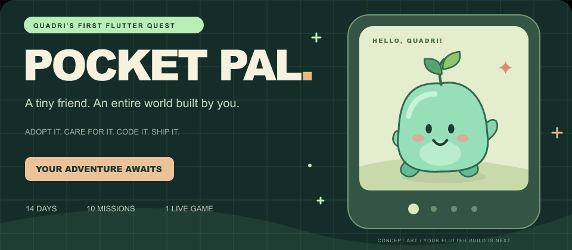
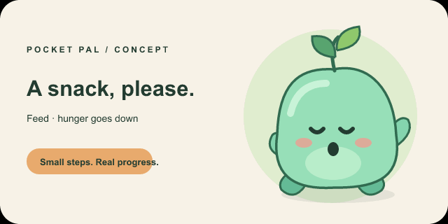

<p align="center">
  
</p>

<h1 align="center">Your first world starts with one tiny friend.</h1>

<p align="center"><strong>QUADRI’S FLUTTER QUEST</strong> · 14 days · 10 missions · One game on the internet</p>

<p align="center">
  <a href="#launch-the-interactive-guide"></a>
  <a href="assignment.md"></a>
  <a href="https://github.com/TIG3R187/the-trickstar/raw/refs/heads/main/Pocket-Pal-Quadri-Assignment.zip"></a>
</p>

> **Hey Quadri. Meet Sprout.** A tiny creature with a big appetite, a short attention span and absolutely no idea what a widget is. Your job? Build its world with Flutter, keep it happy, and send your mentor a link that works.

| Player | Your toolkit | Your finish line |
| :--- | :--- | :--- |
| **Quadri** · junior Flutter developer | Flutter, Dart, local storage and Git | Adopt → feed → play → sleep → refresh → same pet |

## Launch the interactive guide

**Choose a launch route below.** This README is the animated GitHub edition. The interactive guide runs in a browser, where the pet reacts to your clicks and your mission progress is saved.

### Play locally now — no install needed

1. [Download the offline pack](https://github.com/TIG3R187/the-trickstar/raw/refs/heads/main/Pocket-Pal-Quadri-Assignment.zip), or use **Code → Download ZIP** above.
2. **Extract the entire ZIP.** Keep the assets and guide folders beside the HTML files.
3. Double-click **index.html** in the extracted folder. It opens the guide in your browser.

If you already have this repository locally, open **index.html** from File Explorer, or run:

```sh
npm run preview
```

Then open **[http://127.0.0.1:4173](http://127.0.0.1:4173)**. The preview uses Node.js built-ins; npm install is unnecessary for this command.

### Give Quadri a hosted launch link

The repository includes a GitHub Pages workflow. The owner needs to enable Pages once:

1. Push this updated pack to the repository’s **main** branch.
2. Open **[Settings → Pages](https://github.com/TIG3R187/the-trickstar/settings/pages)**. Under **Build and deployment → Source**, choose **GitHub Actions**.
3. Open **[Actions → Publish Pocket Pal guide](https://github.com/TIG3R187/the-trickstar/actions/workflows/deploy-guide.yml)** and run the workflow. Wait for the deployment job to turn green.

**After deployment, the browser launch address is [https://tig3r187.github.io/the-trickstar/](https://tig3r187.github.io/the-trickstar/).** This is the expected Pages address, not a claim that hosting has already been enabled. Use the local route immediately while publishing is pending.

GitHub’s `/blob/main/README.html` URL shows source code. Use the Pages address or an extracted local HTML file to run the guide. [GitHub Pages setup reference](https://docs.github.com/en/pages/getting-started-with-github-pages/using-custom-workflows-with-github-pages).

---

## What you’re bringing to life

<p align="center"></p>

| Give it a home | Give it a personality | Give it a memory |
| :--- | :--- | :--- |
| Pick a style. Choose a name. Make it yours. | Feed it, play with it and watch its mood change. | Save its state. Refresh the page. Find your friend waiting. |

The GIFs are original concept animations. The interactive guide is a working rules playground. **The Flutter game is yours to build.**

## The goal

Quadri, build and deploy a small Flutter virtual pet game that you can explain, maintain and confidently demonstrate. Practise turning an idea into screens, Dart rules, saved state and a working release.

**What you will achieve:** A visitor opens your live web link, adopts and names a pet, feeds it, plays with it, puts it to sleep, sees its mood change and returns after a refresh to find the same pet.

**Suggested duration:** 14 days from your agreed start date. Agree the calendar deadline with your mentor.

**Tools:** Flutter stable, Dart, VS Code or Android Studio, Git, a supported web browser, and shared_preferences. Use setState first; another state management approach is optional if you can explain it.

**Scope:** Required: Flutter web, two pet styles, adoption, a dashboard, care actions, a visible-time timer, mood feedback, local saving, responsive layouts and deployment. Optional: an Android APK, sound, accessories or a small animation. Accounts, a backend, purchases, notifications and offline time progression are outside this assignment.

The Tailwind HTML guide is a reference and rules playground. Your submitted game must be written in Flutter and Dart, inside `app/`. This pack gives you a route to follow; you create the Flutter implementation.

<p align="center"></p>

## Your 14-day route

| When | Mission | Skill unlocked |
| --- | --- | --- |
| Day 1 | 01. Get your launchpad ready | Setup & Git |
| Day 2 | 02. Sketch a tiny world | Planning & layout |
| Days 3–4 | 03. Meet your first pal | Forms & navigation |
| Day 5 | 04. Give your pal a brain | Dart & state |
| Day 6 | 05. Feed. Play. Snooze. | Events & feedback |
| Day 7 | 06. Make the world tick | Timers & lifecycle |
| Days 8–9 | 07. Remember your little friend | JSON & persistence |
| Days 10–11 | 08. Make it feel finished | Layout & accessibility |
| Day 12 | 09. Try to break it, kindly | Testing & debugging |
| Days 13–14 | 10. Put your pal on the internet | Deployment & handoff |

## Your missions

Click a mission to open its route, commands, field notes and completion checks. In the browser guide, you can tick off missions, earn progress and export your checklist.

<details>
<summary><strong>🛠️ MISSION 01 · Get your launchpad ready</strong> — Day 1</summary>

**Your task:** Prepare a Flutter web project in app/ and make your first commit.

**Your route:**

1. Install Flutter stable and your editor extensions. Run flutter doctor and address issues affecting your web target; Android tooling is only needed for the optional APK.
2. Run the commands below from this assignment folder. The HTML guide is your reference; the Dart game belongs in app/.
3. Replace the counter screen with a Pocket Pal title and run it in a supported browser. Initialise Git at the assignment root if needed and commit your starting point.

```sh
flutter doctor
flutter devices
flutter create --platforms=web app
cd app
flutter run -d chrome
```

Run from the assignment root. After cd app, stay in app/ for Flutter commands.

**Mission cleared when:**

- [ ] The Flutter app launches in a browser without runtime errors.
- [ ] The repository contains an app/ folder and a meaningful first commit.

> **Field note:** If Chrome is unavailable, use flutter run -d web-server and open its printed URL in your browser.

</details>

<details>
<summary><strong>🗺️ MISSION 02 · Sketch a tiny world</strong> — Day 2</summary>

**Your task:** Plan adoption and home screens before adding game logic.

**Your route:**

1. Sketch the two screens on paper or in any design tool. Mark the pet picker, name field, three stats and care buttons.
2. Choose two distinct pet styles, a readable palette and at least five mood expressions. Reuse the supplied generic icon or draw your own.
3. Write down the rule table in your own words. Decide where state will live and which widgets can be reused.

**Mission cleared when:**

- [ ] You have two screen sketches and a small component list.
- [ ] You can explain why a higher hunger number means the pet needs food.

> **Field note:** Two colour variants count as two styles. You do not need custom animation or professional illustration.

</details>

<details>
<summary><strong>🌱 MISSION 03 · Meet your first pal</strong> — Days 3–4</summary>

**Your task:** Build adoption with a style picker and a validated name.

**Your route:**

1. Create an adoption screen using a Form and a TextFormField. Trim the name and validate the 2–16 character rule.
2. Let the user select between two pet styles and show the selected state clearly.
3. On Adopt, create the starting pet state and open the dashboard. Do not allow repeated taps to create multiple pets.

**Mission cleared when:**

- [ ] Blank, one-character and overlong names show clear errors.
- [ ] Adopting with a valid name and style opens the correct pet dashboard.

> **Field note:** Start with placeholder art. The important part is a working journey from selection to dashboard.

</details>

<details>
<summary><strong>🧠 MISSION 04 · Give your pal a brain</strong> — Day 5</summary>

**Your task:** Represent the pet as data and show its live statistics.

**Your route:**

1. Create a Pet model with name, style, hunger, happiness, energy and isSleeping. Add JSON conversion when you reach the saving mission.
2. Keep pet state in one clear owner. Use setState to rebuild the screen when it changes. Avoid separate copies of each stat in different widgets.
3. Extract a reusable stat widget with a text value and progress bar. Label hunger clearly: 0 = full, 100 = very hungry.

```dart
int clampStat(int value) => value.clamp(0, 100).toInt();
```

Write this helper in your Dart code; it is not a terminal command.

**Mission cleared when:**

- [ ] The dashboard displays the chosen name, style and all three starting values.
- [ ] Stats have one source of truth and cannot leave the 0–100 range.

> **Field note:** Keep numeric rules in Dart methods that can be tested without rendering the whole screen.

</details>

<details>
<summary><strong>🍎 MISSION 05 · Feed. Play. Snooze.</strong> — Day 6</summary>

**Your task:** Implement the three care actions and mood priority exactly as specified.

**Your route:**

1. Add Feed, Play and Sleep/Wake methods. Apply each change from the rule table, clamp values and refresh the UI.
2. Disable unavailable actions with a visible explanation. Feed and Play must be unavailable while sleeping.
3. Derive mood from the current state in the specified priority order. Update both a text label and the pet expression.

**Mission cleared when:**

- [ ] From the initial state, Feed then Play gives hunger 15, happiness 85 and energy 60.
- [ ] Sleeping blocks Feed and Play, and Wake makes eligible actions available again.
- [ ] A hungry and tired pet displays hungry because that condition has higher priority.

> **Field note:** Mood is computed from the pet; saving a second mood value creates a chance for the two to disagree.

</details>

<details>
<summary><strong>⏱️ MISSION 06 · Make the world tick</strong> — Day 7</summary>

**Your task:** Update needs every 30 seconds while the game is visible.

**Your route:**

1. Use one Timer.periodic with a 30-second interval and apply either the awake or sleeping tick.
2. Observe lifecycle changes, for example with AppLifecycleListener. Cancel on inactive/hidden/paused/detached; start one new timer on resumed. Dispose your listener and timer.
3. Use a temporary shorter interval while developing if helpful, but restore 30 seconds before submission. Do not change stats when returning from a hidden tab.

**Mission cleared when:**

- [ ] One awake tick from the initial state gives hunger 35, happiness 67 and energy 68.
- [ ] One sleeping tick from the initial state gives hunger 32, happiness 70 and energy 80.
- [ ] Hiding and returning to the tab never creates duplicate timers or time-away changes.

> **Field note:** Start the timer after the saved pet has loaded, never inside a widget build method.

</details>

<details>
<summary><strong>💾 MISSION 07 · Remember your little friend</strong> — Days 8–9</summary>

**Your task:** Save locally, restore reliably and handle reset safely.

**Your route:**

1. Run flutter pub add shared_preferences from app/. Follow the package documentation; SharedPreferencesAsync is suitable for a new implementation.
2. Encode one versioned JSON object and save it under a named key. Save after adoption, successful actions and ticks. Await writes in order so older state cannot overwrite newer state.
3. Show loading while reading. Validate decoded types, names, styles and stat ranges. Missing data opens adoption; corrupt or unsupported data shows a recovery message with a confirmed reset.
4. Add New pet with a confirmation dialog. Delete the saved pet only after confirmation, cancel its timer and return to adoption.

```sh
cd app
flutter pub add shared_preferences
```

Run from the root; skip cd app if already inside app/.

**Mission cleared when:**

- [ ] Refreshing restores the name, style, stats and sleeping flag.
- [ ] Canceling reset keeps the pet; confirming reset returns to adoption.
- [ ] A failed save shows a message, and bad saved data cannot crash the app.

> **Field note:** Browser storage belongs to the browser and origin. It will not sync across devices, and clearing site data removes it.

</details>

<details>
<summary><strong>🎨 MISSION 08 · Make it feel finished</strong> — Days 10–11</summary>

**Your task:** Make your screens readable, responsive and pleasant to use.

**Your route:**

1. Try 375px and 1280px viewport widths. Use LayoutBuilder or sensible constraints to adapt the dashboard rather than stretching everything.
2. Use readable text, clear focus states and at least 48×48 logical-pixel care controls. Show text labels for stats and moods instead of relying only on colour.
3. Finish the loading, disabled and error states. Give each mood a recognisable expression, and use your keyboard to complete adoption and care actions.

**Mission cleared when:**

- [ ] No layout overflow at either required width.
- [ ] You can adopt and care for the pet with a keyboard, and every action has understandable feedback.

> **Field note:** Do not spend the last two days adding optional features while the required journey is still broken.

</details>

<details>
<summary><strong>🧪 MISSION 09 · Try to break it, kindly</strong> — Day 12</summary>

**Your task:** Check the rules and edge cases, then record evidence that they work.

**Your route:**

1. Add at least three meaningful automated tests: stat clamping/action math, mood priority, and one user journey such as invalid adoption followed by successful adoption.
2. Manually verify pause/resume, reload, disabled actions, reset cancel/confirm and invalid saved data. Record outcomes in app/TESTING.md.
3. Run the checks below from app/. Fix failures, review warnings and explain any remaining limitation. Recheck any feature you change after a failed test.

```sh
dart format lib test
flutter analyze
flutter test
```

Run inside app/.

**Mission cleared when:**

- [ ] Formatting, analysis and automated tests pass.
- [ ] TESTING.md records actual manual check results, and the browser has no runtime errors.

> **Field note:** A boundary test should prove behaviour, such as feeding at hunger 10 yielding 0 rather than −10.

</details>

<details>
<summary><strong>🚀 MISSION 10 · Put your pal on the internet</strong> — Days 13–14</summary>

**Your task:** Deploy the Flutter game and explain what you built.

**Your route:**

1. Create a Firebase project and install the Firebase CLI following the official guide. Log in, build the app, then initialise classic Firebase Hosting from app/.
2. Select your Firebase project. Set the public directory to build/web, choose Yes for single-page app, No for automatic GitHub builds unless you intend to configure them, and No if asked to overwrite index.html. Do not enable the experimental web-framework integration.
3. Deploy only Hosting using the commands below. Open the returned HTTPS URL and repeat adoption, actions and refresh there. Deploy the Flutter build, not this assignment guide.
4. Update app/README.md with the live URL, setup instructions, screenshots or GIF, design choices and limitations. Include your test evidence and a 3–5 minute walkthrough.

```sh
firebase login
flutter build web --release
firebase init hosting
firebase deploy --only hosting
```

Run inside app/.

**Mission cleared when:**

- [ ] The live HTTPS URL serves the Flutter game and works after a page refresh.
- [ ] Your repository, app README, test notes and walkthrough are ready to review.

> **Field note:** If the default Firebase welcome page appears, check public: build/web in firebase.json, rebuild and redeploy. Do not overwrite Flutter’s generated index.html.

</details>

<details>
<summary><strong>🎮 Open the complete game rules and worked example</strong></summary>

## Game rules

| Rule | Required behaviour |
| --- | --- |
| **Starting state** | Hunger 30, happiness 70, energy 70; awake. All three are integers from 0 to 100. Higher hunger means hungrier; higher happiness and energy mean better. Clamp every change to this range. |
| **Feed** | While awake: hunger −20. Happiness and energy stay unchanged. Disable Feed at hunger 0 and explain why. |
| **Play** | While awake and energy ≥10: happiness +15, energy −10, hunger +5. Otherwise disable Play and explain why. |
| **Sleep / Wake** | Sleep switches to sleeping; Wake switches to awake. Neither toggle instantly changes stats. Feed and Play are disabled while sleeping. A pet can always sleep, even at energy 0. |
| **Awake tick** | After every 30 seconds of visible, active app time: hunger +5, happiness −3, energy −2. |
| **Sleeping tick** | After every 30 seconds of visible, active app time: hunger +2, energy +10, happiness unchanged. Remain asleep at energy 100 until the user chooses Wake. |
| **Mood priority** | Check in this order: sleeping → hungry (hunger ≥70) → tired (energy ≤20) → sad (happiness ≤30) → happy. Show a text label and a different expression or illustration. |
| **Pause and resume** | Cancel the timer when the app is hidden, inactive or disposed. Start one fresh 30-second timer on resume. Do not calculate time away. Save the sleeping flag; a sleeping pet stays asleep after reload. |
| **Saving** | Save name, style, hunger, happiness, energy and sleeping state after adoption, every successful action and each tick. Load before showing the dashboard. Use a versioned JSON object; missing data opens adoption. Invalid saved data shows a recovery message and offers a confirmed reset. |
| **Naming and reset** | Offer at least two visually distinct styles. Trim names and accept 2–16 characters. Show an inline error for invalid names. A New pet action must ask for confirmation before deleting the existing pet and returning to adoption. |

**Worked check:** starting at 30 / 70 / 70 (hunger / happiness / energy), Feed gives 10 / 70 / 70; Play then gives 15 / 85 / 60. Sleep changes only the sleeping flag. The next sleeping tick gives 17 / 85 / 70.

</details>

## Definition of done

- [ ] Adopt either of two pet styles with a valid 2–16 character trimmed name.
- [ ] See hunger, happiness and energy as numbers and labelled indicators.
- [ ] Feed, Play and Sleep/Wake follow every action rule and show disabled reasons.
- [ ] All values stay in 0–100 and mood follows the specified priority.
- [ ] One visible-time timer applies the correct 30-second updates; hidden time has no effect.
- [ ] Refresh restores the same pet, values and sleep state without a flash of default state.
- [ ] Missing, invalid or failed storage operations have a usable recovery or error state.
- [ ] New pet asks for confirmation; cancel keeps the pet and confirm opens adoption.
- [ ] The game works at 375px and 1280px widths and is usable with a keyboard.
- [ ] Formatting, analysis and at least three meaningful automated tests pass.
- [ ] The deployed HTTPS URL passes adoption, action and refresh checks.
- [ ] Submission includes repository, live URL, app README, TESTING.md, screenshots/GIF and a walkthrough.

## What to submit

- A live HTTPS link to the Flutter game, verified in a fresh browser session.
- A GitHub repository containing the Flutter app in app/ and a useful commit history.
- app/README.md with run instructions, live URL, features, screenshots or a GIF, decisions and known limitations.
- app/TESTING.md with automated check results and manual test evidence.
- A 3–5 minute recorded walkthrough or live demonstration: adopt, care, sleep, reload and reset; explain a state change and one bug you fixed.

**Daily check-in:** tell your mentor what you completed, what you will do next, and one blocker or question. Commit when a meaningful piece works.

**Bonus, after the core works:** add one small animation, a muteable sound effect, an accessory unlock, or an Android APK. Explain any extra permissions or packages you choose.

<details>
<summary><strong>🏆 Open your mentor’s scorecard — 100 points</strong></summary>

## How your work will be reviewed

| Area | Points | What your mentor will look for |
| --- | ---: | --- |
| Game behaviour | 30 | Adoption, action math, mood, timer and boundary conditions. |
| Persistence & recovery | 20 | Reliable reload, ordered saves, loading/error states and safe reset. |
| Code clarity | 15 | Understandable Dart, one owner of state and reusable widgets. |
| UI & accessibility | 15 | Responsive layouts, readable feedback, labels and keyboard access. |
| Testing | 10 | Meaningful automated tests plus recorded manual verification. |
| Deployment & explanation | 10 | Working public game URL, documentation and a clear walkthrough. |
| **Total** | **100** | Core requirements come first. Bonus features do not replace them. |

Be ready to explain your code. Documentation, tutorials and AI assistance are allowed as learning aids; keep a short note of what you used and verify every change. Your mentor may ask you to change a rule live.

</details>

<details>
<summary><strong>📁 Where your work goes</strong></summary>

```text
pocket-pal-assignment/
├── assignment.md        # Complete game specification
├── README.md            # This animated quest hub
├── index.html           # Browser / GitHub Pages entry
├── README.html          # Interactive Tailwind guide
├── assets/              # Original icon, animation and artwork
├── guide/               # Guide content, styles and interactions
├── .github/workflows/   # GitHub Pages deployment
├── scripts/             # Build, preview and validation tools
└── app/                 # Quadri creates this in mission 01
    ├── lib/
    ├── test/
    ├── README.md        # Document the Flutter game here
    └── TESTING.md       # Record real test results here
```

A simple Flutter structure is `lib/models/pet.dart`, `lib/screens/`, `lib/widgets/` and `lib/services/pet_storage.dart`. Start with setState and one clear owner of the pet state.

</details>

<details>
<summary><strong>🔧 Customise or rebuild this assignment pack</strong></summary>

Run these commands from the assignment root to install the guide’s development dependencies and regenerate content, animation and styles:

```sh
npm ci
npm run assets
npm run build
npm run check
npm run site
```

Edit `guide/content.js` for the shared brief. `npm run build` regenerates both Markdown documents and compiles Tailwind CSS. Update this generator if you want to change the README layout; direct edits to generated Markdown are overwritten.

`npm run test:browser` checks the guide’s rules, storage, links, animation and layouts. It uses an installed Playwright Chromium or Windows Edge. You can set `POCKET_PAL_BROWSER` to another Chromium executable or install Chromium with `npx playwright install chromium`.

The guide’s npm tools are separate from Quadri’s Flutter tools. The deployment workflow publishes only the guide and brief; Quadri deploys his Flutter game separately in mission 10.

</details>

<details>
<summary><strong>📚 Your official learning library</strong></summary>

## Official learning resources

- [Install Flutter](https://docs.flutter.dev/install)
- [Flutter forms and validation](https://docs.flutter.dev/cookbook/forms/validation)
- [Simple state management](https://docs.flutter.dev/data-and-backend/state-mgmt/simple)
- [Dart Timer.periodic](https://api.dart.dev/dart-async/Timer/Timer.periodic.html)
- [Flutter AppLifecycleListener](https://api.flutter.dev/flutter/widgets/AppLifecycleListener-class.html)
- [Local key-value storage](https://docs.flutter.dev/cookbook/persistence/key-value)
- [shared_preferences package](https://pub.dev/packages/shared_preferences)
- [Flutter testing](https://docs.flutter.dev/testing/overview)
- [Flutter web release](https://docs.flutter.dev/deployment/web)
- [Firebase CLI installation](https://firebase.google.com/docs/cli#install_the_firebase_cli)
- [Firebase Hosting quickstart](https://firebase.google.com/docs/hosting/quickstart)
- [Tailwind CLI (for the guide only)](https://tailwindcss.com/docs/installation/tailwind-cli)
- [GitHub expandable sections](https://docs.github.com/en/get-started/writing-on-github/working-with-advanced-formatting/organizing-information-with-collapsed-sections)

</details>

---

<p align="center"></p>
<p align="center"><strong>Build one small thing. Make it work. Give it a little life.</strong><br>Quadri, your finish line is a live game and code you can explain.</p>

[Back to the launch options ↑](#launch-the-interactive-guide) · [Full specification](assignment.md) · [Artwork you can reuse](assets/README.md)
