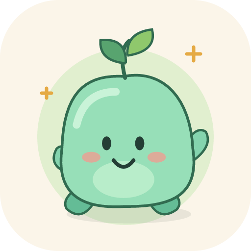

# Pocket Pal — Quadri’s Flutter assignment



**Assigned to:** Quadri · **Level:** about one month of Flutter/Dart · **Deliverable:** a deployed virtual pet game

[Quest hub](README.md) · [How to launch the interactive guide](README.md#launch-the-interactive-guide)

**Start here, Quadri:** [Fix your workspace and try the one-file checkpoint](START_HERE.md). If your existing project is flutter_application_1/, keep it. Every app/ path below refers to your actual Flutter project folder. Follow one checkpoint at a time before using the full reference below.

## The goal

Quadri, build and deploy a small Flutter virtual pet game that you can explain, maintain and confidently demonstrate. Practise turning an idea into screens, Dart rules, saved state and a working release.

**What you will achieve:** A visitor opens your live web link, adopts and names a pet, feeds it, plays with it, puts it to sleep, sees its mood change and returns after a refresh to find the same pet.

**Suggested duration:** 14 days from your agreed start date. Agree the calendar deadline with your mentor.

**Tools:** Flutter stable, Dart, VS Code or Android Studio, Git, a supported web browser, and shared_preferences. Use setState first; another state management approach is optional if you can explain it.

**Scope:** Required: Flutter web, two pet styles, adoption, a dashboard, care actions, a visible-time timer, mood feedback, local saving, responsive layouts and deployment. Optional: an Android APK, sound, accessories or a small animation. Accounts, a backend, purchases, notifications and offline time progression are outside this assignment.

The Tailwind HTML guide is a reference and rules playground. Your submitted game must be written in Flutter and Dart, inside `app/`. This pack gives you a route to follow; you create the Flutter implementation.

## Quadri’s VS Code workbench

Start with START_HERE.md and its small checkpoints before using this reference. Paths below use app/ as the Flutter project folder. If your existing folder is flutter_application_1/, use it instead and do not create another project. Open that folder itself in VS Code so pubspec.yaml and lib/ are at the top of Explorer.

1. Open VS Code. Choose File → Open Folder and select the extracted or cloned assignment folder containing assignment.md. Use View → Explorer to see the files.
2. Press Ctrl+Shift+X. Install Flutter by Dart Code; its Dart dependency is installed with it. Install the Flutter SDK using the official instructions if the flutter command is unavailable, then restart VS Code.
3. Choose Terminal → New Terminal. On Windows, use the terminal dropdown to select PowerShell. Run Get-Location and Get-ChildItem; confirm you are at the assignment root before creating app/.
4. Run the mission 01 setup commands only if you do not have a Flutter project yet. If flutter_application_1/pubspec.yaml or app/pubspec.yaml already exists, keep that project, open its folder directly, and run flutter pub get there.
5. After creation, choose File → Open Folder → app. This is your Flutter workspace. Open a fresh terminal: Get-Location should end in app, and Get-ChildItem pubspec.yaml should find the file.
6. Use Explorer → New Folder / New File to create the exact paths in each mission. Right-click lib to create models, screens, widgets and services. Save files with Ctrl+S.
7. Click the device name in the VS Code status bar and select Chrome. Press F5 to debug. If Chrome is unavailable, use flutter run -d web-server --web-port 7357 and open the printed address.
8. Use the Hot Reload button after a widget edit. Use Flutter: Hot Restart from Ctrl+Shift+P after changing initial values, initState or main. Use View → Problems for analyzer errors and Debug Console for runtime errors.
9. Keep one run session open. Use a second terminal for flutter analyze and flutter test. Stop the run session with the red Stop button, or Ctrl+C in the terminal that launched flutter run.
10. At the end of each mission, run the stated checkpoint and make a meaningful Git commit. Use Source Control (Ctrl+Shift+G) to review the changed files before committing.

### Files and responsibilities

```text
app/
├── .vscode/launch.json
├── assets/images/pocket-pal-icon.png
├── lib/
│   ├── main.dart
│   ├── models/pet.dart
│   ├── screens/adoption_screen.dart
│   ├── screens/game_screen.dart
│   ├── services/pet_storage.dart
│   ├── services/visible_pet_clock.dart
│   └── widgets/pet_stat.dart
├── test/pet_test.dart
├── pubspec.yaml
├── README.md
└── TESTING.md
```

| File | Responsibility |
| --- | --- |
| `app/lib/main.dart` | Starts MaterialApp. Begin with the mission 01 screen, then set home to GameScreen after creating it. |
| `app/lib/models/pet.dart` | Pet fields, initial values, feed, mood priority, copyWith and validated JSON conversion. |
| `app/lib/screens/adoption_screen.dart` | Name form, two style choices and onAdopt callback. |
| `app/lib/screens/game_screen.dart` | One stateful parent: load, adopt, update, save, start/stop the clock and confirm reset. You implement this screen. |
| `app/lib/widgets/pet_stat.dart` | A reusable, labelled stat indicator. |
| `app/lib/services/pet_storage.dart` | Read, save and delete one pet key; queue writes to preserve order. |
| `app/lib/services/visible_pet_clock.dart` | One 30-second timer that pauses when the app is not resumed. |
| `app/test/pet_test.dart` | Boundary and mood tests; add a widget journey test separately. |
| `app/TESTING.md` | Record test command output and manual checks with actual results. |

**How the pieces connect:** GameScreen is the single owner of the current Pet. AdoptionScreen sends a name and style to its parent. PetStat displays values and does not own a second copy. PetStorage saves snapshots. VisiblePetClock asks GameScreen to apply a tick; it never owns the pet.

**How to use the snippets:** Code blocks labelled Complete file can be copied into the named file. Member fragments belong inside the stated class, not below its closing brace. Imports go at the top. Widget fragments replace part of a build method. Reference helpers in learning/snippets/ end in .dart.txt so VS Code does not analyze them as source files. Copy their contents into the stated destination inside your Flutter project. Do not run the reference folder. Start with the one-file checkpoint before these longer helpers.

## Game rules

| Rule | Required behaviour |
| --- | --- |
| **Starting state** | Hunger 30, happiness 70, energy 70; awake. All three are integers from 0 to 100. Higher hunger means hungrier; higher happiness and energy mean better. Clamp every change to this range. |
| **Feed** | While awake: hunger −20. Happiness and energy stay unchanged. Disable Feed at hunger 0 and explain why. |
| **Play** | While awake and energy ≥10: happiness +15, energy −10, hunger +5. Otherwise disable Play and explain why. |
| **Sleep / Wake** | Sleep switches to sleeping; Wake switches to awake. Neither toggle instantly changes stats. Feed and Play are disabled while sleeping. A pet can always sleep, even at energy 0. |
| **Awake tick** | After every 30 seconds of visible, active app time: hunger +5, happiness −3, energy −2. |
| **Sleeping tick** | After every 30 seconds of visible, active app time: hunger +2, energy +10, happiness unchanged. Remain asleep at energy 100 until the user chooses Wake. |
| **Mood priority** | Check in this order: sleeping → hungry (hunger ≥70) → tired (energy ≤20) → sad (happiness ≤30) → happy. Show a text label and a different expression or illustration. |
| **Pause and resume** | Cancel the timer when the app is hidden, inactive or disposed. Start one fresh 30-second timer on resume. Do not calculate time away. Save the sleeping flag; a sleeping pet stays asleep after reload. |
| **Saving** | Save name, style, hunger, happiness, energy and sleeping state after adoption, every successful action and each tick. Load before showing the dashboard. Use a versioned JSON object; missing data opens adoption. Invalid saved data shows a recovery message and offers a confirmed reset. |
| **Naming and reset** | Offer at least two visually distinct styles. Trim names and accept 2–16 characters. Show an inline error for invalid names. A New pet action must ask for confirmation before deleting the existing pet and returning to adoption. |

**Worked check:** starting at 30 / 70 / 70 (hunger / happiness / energy), Feed gives 10 / 70 / 70; Play then gives 15 / 85 / 60. Sleep changes only the sleeping flag. The next sleeping tick gives 17 / 85 / 70.

## Your 14-day route

| When | Mission | Skill unlocked |
| --- | --- | --- |
| Day 1 | 01. Get your launchpad ready | Setup & Git |
| Day 2 | 02. Sketch a tiny world | Planning & layout |
| Days 3–4 | 03. Meet your first pal | Forms & navigation |
| Day 5 | 04. Give your pal a brain | Dart & state |
| Day 6 | 05. Feed. Play. Snooze. | Events & feedback |
| Day 7 | 06. Make the world tick | Timers & lifecycle |
| Days 8–9 | 07. Remember your little friend | JSON & persistence |
| Days 10–11 | 08. Make it feel finished | Layout & accessibility |
| Day 12 | 09. Try to break it, kindly | Testing & debugging |
| Days 13–14 | 10. Put your pal on the internet | Deployment & handoff |

## Step-by-step assignment

### 01. Get your launchpad ready — Day 1

**Your task:** Prepare a Flutter web project in app/ and make your first commit.

**Your route:**

1. Install Flutter stable and your editor extensions. Run flutter doctor and address issues affecting your web target; Android tooling is only needed for the optional APK.
2. Run the commands below from this assignment folder. The HTML guide is your reference; the Dart game belongs in app/.
3. Replace the counter screen with a Pocket Pal title and run it in a supported browser. Initialise Git at the assignment root if needed and commit your starting point.

```sh
Get-Location
Get-ChildItem
flutter doctor
flutter devices
flutter create --project-name pocket_pal --platforms=web app
cd app
flutter run -d chrome --web-port 7357
```

Run from the assignment root. After cd app, stay in app/ for Flutter commands.

**In VS Code:**

1. Existing project: open flutter_application_1/ (or your existing app folder) directly and run flutter pub get. Skip the create command below. New project only: run flutter create from the assignment root, then open app/.
2. Run the existing app once before changing files. Work through START_HERE.md checkpoint 1 if the full assignment feels too large. In the longer route, replace lib/main.dart with the mission file below after backing it up.
3. Create .vscode/launch.json inside the actual Flutter folder. Select Pocket Pal (Chrome) in Run and Debug and press F5. Stop any terminal-launched run first.

**Files to work on:** `app/lib/main.dart`, `app/.vscode/launch.json`

#### Your first runnable screen

**Location:** `app/lib/main.dart`

**Placement:** Complete file. Replace the generated main.dart for this mission.

```dart
import 'package:flutter/material.dart';

void main() => runApp(const PocketPalApp());

class PocketPalApp extends StatelessWidget {
  const PocketPalApp({super.key});

  @override
  Widget build(BuildContext context) {
    return MaterialApp(
      debugShowCheckedModeBanner: false,
      title: 'Pocket Pal',
      theme: ThemeData(colorSchemeSeed: Colors.green),
      home: const Scaffold(
        body: Center(child: Text('Hello Quadri. Let’s build Pocket Pal!')),
      ),
    );
  }
}
```

Checkpoint: the browser displays the greeting. Later, import screens/game_screen.dart and replace home with const GameScreen() after that widget exists.

#### Run the same browser origin every time

**Location:** `app/.vscode/launch.json`

**Placement:** Complete JSON file. This assumes app/ is the open VS Code folder.

```json
{
  "version": "0.2.0",
  "configurations": [
    {
      "name": "Pocket Pal (Chrome)",
      "request": "launch",
      "type": "dart",
      "program": "lib/main.dart",
      "deviceId": "chrome",
      "args": ["--web-port", "7357"]
    }
  ]
}
```

Use this launch configuration or the terminal command, not both at the same time. Keeping port 7357 makes refresh/storage checks easier.

**Mission cleared when:**

- [ ] The Flutter app launches in a browser without runtime errors.
- [ ] The repository contains an app/ folder and a meaningful first commit.

> **Field note:** If Chrome is unavailable, use flutter run -d web-server and open its printed URL in your browser.

### 02. Sketch a tiny world — Day 2

**Your task:** Plan adoption and home screens before adding game logic.

**Your route:**

1. Sketch the two screens on paper or in any design tool. Mark the pet picker, name field, three stats and care buttons.
2. Choose two distinct pet styles, a readable palette and at least five mood expressions. Reuse the supplied generic icon or draw your own.
3. Write down the rule table in your own words. Decide where state will live and which widgets can be reused.

**In VS Code:**

1. With app/ open, right-click lib in Explorer and create models, screens, services and widgets. Create assets/images under app/.
2. Sketch adoption and dashboard. Write a short plan in app/README.md: screens, file responsibilities and the rule priority.
3. Copy the supplied PNG and declare it in the existing flutter section of pubspec.yaml. Do not add another flutter section.

**Files to work on:** `app/README.md`, `app/assets/images/pocket-pal-icon.png`, `app/pubspec.yaml`

#### Create the working folders

**Location:** `Terminal inside app/`

**Placement:** PowerShell commands. Existing directories are preserved.

```powershell
New-Item -ItemType Directory -Force lib/models,lib/screens,lib/services,lib/widgets,assets/images
Copy-Item ../assets/pocket-pal-icon.png assets/images/pocket-pal-icon.png
flutter pub get
```

Use Explorer instead if you prefer. Keep test/ from the generated project. Create each Dart file when its mission introduces it.

#### Register the mascot image

**Location:** `app/pubspec.yaml`

**Placement:** Edit the existing flutter block; this is a YAML fragment.

```yaml
flutter:
  uses-material-design: true
  assets:
    - assets/images/
```

After saving, run flutter pub get from app/. Display it with Image.asset('assets/images/pocket-pal-icon.png'). Create the second visual style yourself.

**Mission cleared when:**

- [ ] You have two screen sketches and a small component list.
- [ ] You can explain why a higher hunger number means the pet needs food.

> **Field note:** Two colour variants count as two styles. You do not need custom animation or professional illustration.

### 03. Meet your first pal — Days 3–4

**Your task:** Build adoption with a style picker and a validated name.

**Your route:**

1. Create an adoption screen using a Form and a TextFormField. Trim the name and validate the 2–16 character rule.
2. Let the user select between two pet styles and show the selected state clearly.
3. On Adopt, create the starting pet state and open the dashboard. Do not allow repeated taps to create multiple pets.

**In VS Code:**

1. Create lib/screens/adoption_screen.dart and copy the complete widget below. It has no dependency on the Pet model yet.
2. To try it now, import screens/adoption_screen.dart in main.dart and temporarily use AdoptionScreen(onAdopt: (name, style) async { debugPrint(name + ": " + style); }) as home.
3. In the next mission, replace that temporary callback with the GameScreen parent’s adoption method. Keep the form UI in this file.

**Files to work on:** `app/lib/screens/adoption_screen.dart`, `app/lib/main.dart`

#### A form with two choices and a parent callback

**Location:** `app/lib/screens/adoption_screen.dart`

**Placement:** Complete file. The parent decides what to do after adoption.

```dart
import 'package:flutter/material.dart';

class AdoptionScreen extends StatefulWidget {
  const AdoptionScreen({super.key, required this.onAdopt});
  final Future<void> Function(String name, String style) onAdopt;

  @override
  State<AdoptionScreen> createState() => _AdoptionScreenState();
}

class _AdoptionScreenState extends State<AdoptionScreen> {
  final _formKey = GlobalKey<FormState>();
  final _name = TextEditingController();
  String _style = 'mint';
  bool _submitting = false;

  Future<void> _submit() async {
    if (_submitting || !_formKey.currentState!.validate()) return;
    setState(() => _submitting = true);
    try {
      await widget.onAdopt(_name.text.trim(), _style);
    } finally {
      if (mounted) setState(() => _submitting = false);
    }
  }

  @override
  void dispose() {
    _name.dispose();
    super.dispose();
  }

  @override
  Widget build(BuildContext context) {
    return Scaffold(
      appBar: AppBar(title: const Text('Adopt a Pocket Pal')),
      body: SingleChildScrollView(
        padding: const EdgeInsets.all(24),
        child: Form(
          key: _formKey,
          child: Column(
            crossAxisAlignment: CrossAxisAlignment.stretch,
            children: [
              TextFormField(
                controller: _name,
                decoration: const InputDecoration(labelText: 'Pet name'),
                validator: (value) {
                  final length = (value ?? '').trim().length;
                  return length < 2 || length > 16
                      ? 'Use a name with 2–16 characters.'
                      : null;
                },
              ),
              const SizedBox(height: 16),
              Wrap(
                spacing: 12,
                children: ['mint', 'mango'].map((style) {
                  return ChoiceChip(
                    label: Text(style),
                    selected: _style == style,
                    onSelected: _submitting
                        ? null
                        : (_) => setState(() => _style = style),
                  );
                }).toList(),
              ),
              const SizedBox(height: 24),
              FilledButton(
                onPressed: _submitting ? null : _submit,
                child: Text(_submitting ? 'Adopting…' : 'Adopt my pal'),
              ),
            ],
          ),
        ),
      ),
    );
  }
}
```

Try empty input, one character, 17 characters and a valid name. The chip labels are a starting point; add a visible pet preview for each style. When storage is introduced, the parent must catch errors and show feedback.

**Mission cleared when:**

- [ ] Blank, one-character and overlong names show clear errors.
- [ ] Adopting with a valid name and style opens the correct pet dashboard.

> **Field note:** Start with placeholder art. The important part is a working journey from selection to dashboard.

### 04. Give your pal a brain — Day 5

**Your task:** Represent the pet as data and show its live statistics.

**Your route:**

1. Create a Pet model with name, style, hunger, happiness, energy and isSleeping. Add JSON conversion when you reach the saving mission.
2. Keep pet state in one clear owner. Use setState to rebuild the screen when it changes. Avoid separate copies of each stat in different widgets.
3. Extract a reusable stat widget with a text value and progress bar. Label hunger clearly: 0 = full, 100 = very hungry.

```dart
int clampStat(int value) => value.clamp(0, 100).toInt();
```

Write this helper in your Dart code; it is not a terminal command.

**In VS Code:**

1. Create lib/models/pet.dart using the complete helper below. Read the defaults, copyWith, mood getter and JSON methods before using them.
2. Create a StatefulWidget named GameScreen in lib/screens/game_screen.dart. Its State owns Pet? _pet. Import material.dart, ../models/pet.dart and adoption_screen.dart.
3. Create Future<void> _adopt(String name, String style) async { setState(() => _pet = Pet(name: name, style: style)); }. For now, when _pet is null return AdoptionScreen(onAdopt: _adopt) from build; otherwise return your dashboard Scaffold.
4. Import screens/game_screen.dart in main.dart and change MaterialApp.home to const GameScreen(). Add saving and startup loading in mission 07.

**Files to work on:** `app/lib/models/pet.dart`, `app/lib/screens/game_screen.dart`, `app/lib/main.dart`

#### One model, one source of truth

**Location:** `app/lib/models/pet.dart`

**Placement:** Complete file. Feed is demonstrated; build Play using copyWith in mission 05.

```dart
class Pet {
  const Pet({
    required this.name,
    required this.style,
    this.hunger = 30,
    this.happiness = 70,
    this.energy = 70,
    this.isSleeping = false,
  });

  final String name;
  final String style;
  final int hunger;
  final int happiness;
  final int energy;
  final bool isSleeping;

  static int clampStat(int value) => value.clamp(0, 100).toInt();

  Pet copyWith({int? hunger, int? happiness, int? energy, bool? isSleeping}) {
    return Pet(
      name: name,
      style: style,
      hunger: clampStat(hunger ?? this.hunger),
      happiness: clampStat(happiness ?? this.happiness),
      energy: clampStat(energy ?? this.energy),
      isSleeping: isSleeping ?? this.isSleeping,
    );
  }

  Pet feed() => isSleeping ? this : copyWith(hunger: hunger - 20);

  String get mood {
    if (isSleeping) return 'sleeping';
    if (hunger >= 70) return 'hungry';
    if (energy <= 20) return 'tired';
    if (happiness <= 30) return 'sad';
    return 'happy';
  }

  Map<String, Object> toJson() => {
    'version': 1,
    'name': name,
    'style': style,
    'hunger': hunger,
    'happiness': happiness,
    'energy': energy,
    'isSleeping': isSleeping,
  };

  factory Pet.fromJson(Map<String, dynamic> json) {
    final name = json['name'];
    final style = json['style'];
    final sleeping = json['isSleeping'];
    if (json['version'] != 1 ||
        name is! String ||
        name.trim() != name || name.length < 2 || name.length > 16 ||
        (style != 'mint' && style != 'mango') || sleeping is! bool) {
      throw const FormatException('Invalid or unsupported pet save.');
    }
    int readStat(String key) {
      final value = json[key];
      if (value is! int || value < 0 || value > 100) {
        throw FormatException('Invalid stat: $key');
      }
      return value;
    }
    return Pet(
      name: name,
      style: style as String,
      hunger: readStat('hunger'),
      happiness: readStat('happiness'),
      energy: readStat('energy'),
      isSleeping: sleeping,
    );
  }
}
```

Use copyWith for stat changes so clamping happens in one place. toJson/fromJson are ready for mission 07. Do not store a separate mood string; derive it from the current pet.

#### Start the parent screen with a working adoption handoff

**Location:** `app/lib/screens/game_screen.dart`

**Placement:** Complete starter file for mission 04. Extend this same State class in later missions.

```dart
import 'package:flutter/material.dart';
import '../models/pet.dart';
import 'adoption_screen.dart';

class GameScreen extends StatefulWidget {
  const GameScreen({super.key});

  @override
  State<GameScreen> createState() => _GameScreenState();
}

class _GameScreenState extends State<GameScreen> {
  Pet? _pet;

  Future<void> _adopt(String name, String style) async {
    setState(() => _pet = Pet(name: name, style: style));
    // Mission 06: start the clock after adoption.
    // Mission 07: save first, handle errors, then show the new pet.
  }

  @override
  Widget build(BuildContext context) {
    if (_pet == null) return AdoptionScreen(onAdopt: _adopt);
    final pet = _pet!;
    return Scaffold(
      appBar: AppBar(title: Text(pet.name)),
      body: Padding(
        padding: const EdgeInsets.all(24),
        child: Column(
          crossAxisAlignment: CrossAxisAlignment.start,
          children: [
            Text('Style: ${pet.style}'),
            Text('Mood: ${pet.mood}'),
            Text('Hunger: ${pet.hunger}'),
            Text('Happiness: ${pet.happiness}'),
            Text('Energy: ${pet.energy}'),
            // Mission 05: add the care controls here.
            // Mission 08: replace repeated stat text with PetStat.
          ],
        ),
      ),
    );
  }
}
```

After creating this file, import screens/game_screen.dart in main.dart and use home: const GameScreen(). This shell deliberately has no care controls, timer, storage or reset yet; add them in the next missions without creating a second State owner.

**Mission cleared when:**

- [ ] The dashboard displays the chosen name, style and all three starting values.
- [ ] Stats have one source of truth and cannot leave the 0–100 range.

> **Field note:** Keep numeric rules in Dart methods that can be tested without rendering the whole screen.

### 05. Feed. Play. Snooze. — Day 6

**Your task:** Implement the three care actions and mood priority exactly as specified.

**Your route:**

1. Add Feed, Play and Sleep/Wake methods. Apply each change from the rule table, clamp values and refresh the UI.
2. Disable unavailable actions with a visible explanation. Feed and Play must be unavailable while sleeping.
3. Derive mood from the current state in the specified priority order. Update both a text label and the pet expression.

**In VS Code:**

1. In GameScreen State, add the _changePet method below. It updates the one current Pet and asks the storage helper to save a snapshot after mission 07.
2. Add Feed, Play and Sleep/Wake buttons. Use null for an unavailable onPressed callback, plus nearby text explaining why it is disabled.
3. Implement Play yourself with copyWith: happiness +15, energy −10, hunger +5. Guard against sleeping or energy below 10. Toggle isSleeping for Sleep/Wake and use pet.mood to select an expression.

**Files to work on:** `app/lib/screens/game_screen.dart`, `app/lib/models/pet.dart`

#### Update parent state before rebuilding its widgets

**Location:** `app/lib/screens/game_screen.dart`

**Placement:** Member fragment inside State<GameScreen>. Requires Pet? _pet. Add the save call in mission 07.

```dart
void _changePet(Pet Function(Pet) change) {
  final current = _pet;
  if (current == null) return;
  final next = change(current);
  setState(() => _pet = next);
  // Mission 07: add _saveSnapshot(next); here.
}
```

The callback receives the newest pet. For Feed, call _changePet((pet) => pet.feed()). Keep state mutation outside build.

#### Wire one button, then build the others

**Location:** `app/lib/screens/game_screen.dart`

**Placement:** Widget fragment inside your dashboard build. Define final pet = _pet! after the null/adoption branch.

```dart
FilledButton(
  onPressed: pet.isSleeping || pet.hunger == 0
      ? null
      : () => _changePet((current) => current.feed()),
  child: const Text('Feed'),
)
// Put the reason in a Text widget beside the controls:
// sleeping: 'Wake your pet before feeding.'
// hunger == 0: 'Your pet is full.'
```

For Play, guard both in the UI and in your rule method. Test Feed then Play from the initial state: 15 hunger, 85 happiness, 60 energy.

**Mission cleared when:**

- [ ] From the initial state, Feed then Play gives hunger 15, happiness 85 and energy 60.
- [ ] Sleeping blocks Feed and Play, and Wake makes eligible actions available again.
- [ ] A hungry and tired pet displays hungry because that condition has higher priority.

> **Field note:** Mood is computed from the pet; saving a second mood value creates a chance for the two to disagree.

### 06. Make the world tick — Day 7

**Your task:** Update needs every 30 seconds while the game is visible.

**Your route:**

1. Use one Timer.periodic with a 30-second interval and apply either the awake or sleeping tick.
2. Observe lifecycle changes, for example with AppLifecycleListener. Cancel on inactive/hidden/paused/detached; start one new timer on resumed. Dispose your listener and timer.
3. Use a temporary shorter interval while developing if helpful, but restore 30 seconds before submission. Do not change stats when returning from a hidden tab.

**In VS Code:**

1. Create lib/services/visible_pet_clock.dart with the complete helper. It owns the timer and lifecycle listener only.
2. In GameScreen State, import ../services/visible_pet_clock.dart. Add late final VisiblePetClock _clock; then create _clock = VisiblePetClock(onTick: _tickPet) in initState after super.initState().
3. Call _clock.start() after adoption and, in mission 07, after successful restore of an existing pet. Call _clock.stop() when returning to adoption. In dispose, call _clock.dispose() before super.dispose().
4. Add _tickPet from the fragment below. Do not create a clock or start a timer inside build.

**Files to work on:** `app/lib/services/visible_pet_clock.dart`, `app/lib/screens/game_screen.dart`

#### One clock that follows visible app time

**Location:** `app/lib/services/visible_pet_clock.dart`

**Placement:** Complete file. Call start only when a pet is ready.

```dart
import 'dart:async';
import 'package:flutter/widgets.dart';

class VisiblePetClock {
  VisiblePetClock({required this.onTick}) {
    _listener = AppLifecycleListener(onStateChange: (_) => _restart());
  }

  final VoidCallback onTick;
  late final AppLifecycleListener _listener;
  Timer? _timer;
  bool _enabled = false;

  void start() {
    _enabled = true;
    _restart();
  }

  void stop() {
    _enabled = false;
    _timer?.cancel();
    _timer = null;
  }

  void _restart() {
    _timer?.cancel();
    _timer = null;
    if (!_enabled ||
        WidgetsBinding.instance.lifecycleState != AppLifecycleState.resumed) {
      return;
    }
    _timer = Timer.periodic(const Duration(seconds: 30), (_) => onTick());
  }

  void dispose() {
    stop();
    _listener.dispose();
  }
}
```

When the app resumes, this starts a fresh 30 seconds. It does not calculate time away and it does not alter the sleeping flag.

#### Apply the correct tick to the current pet

**Location:** `app/lib/screens/game_screen.dart`

**Placement:** Member fragment inside State<GameScreen>. Requires _changePet from mission 05.

```dart
void _tickPet() {
  _changePet((pet) => pet.isSleeping
      ? pet.copyWith(hunger: pet.hunger + 2, energy: pet.energy + 10)
      : pet.copyWith(
          hunger: pet.hunger + 5,
          happiness: pet.happiness - 3,
          energy: pet.energy - 2,
        ));
}
```

Try awake and sleeping states separately. Keep the timer interval at 30 seconds for submission.

**Mission cleared when:**

- [ ] One awake tick from the initial state gives hunger 35, happiness 67 and energy 68.
- [ ] One sleeping tick from the initial state gives hunger 32, happiness 70 and energy 80.
- [ ] Hiding and returning to the tab never creates duplicate timers or time-away changes.

> **Field note:** Start the timer after the saved pet has loaded, never inside a widget build method.

### 07. Remember your little friend — Days 8–9

**Your task:** Save locally, restore reliably and handle reset safely.

**Your route:**

1. Run flutter pub add shared_preferences from app/. Follow the package documentation; SharedPreferencesAsync is suitable for a new implementation.
2. Encode one versioned JSON object and save it under a named key. Save after adoption, successful actions and ticks. Await writes in order so older state cannot overwrite newer state.
3. Show loading while reading. Validate decoded types, names, styles and stat ranges. Missing data opens adoption; corrupt or unsupported data shows a recovery message with a confirmed reset.
4. Add New pet with a confirmation dialog. Delete the saved pet only after confirmation, cancel its timer and return to adoption.

```sh
cd app
flutter pub add shared_preferences
```

Run from the root; skip cd app if already inside app/.

**In VS Code:**

1. From the app/ terminal, run flutter pub add shared_preferences. Create lib/services/pet_storage.dart using the complete helper.
2. In GameScreen State, import ../services/pet_storage.dart and create final _storage = PetStorage();. Add _loading = true and String? _loadError. Start _restorePet from initState after creating the clock.
3. In build, show a loading spinner while _loading is true, a recovery screen when _loadError is set, AdoptionScreen when _pet is null, and the dashboard otherwise. Restore must finish before choosing the adoption/dashboard branch.
4. Add _saveSnapshot from the fragment below and call it at the end of _changePet. In _adopt, save the new Pet first; on success set _pet and start the clock. On failure show feedback and stay on adoption.
5. Build New pet confirmation with showDialog<bool>. If the answer is not true, return. Stop the clock and disable controls while awaiting _storage.clear(); only on success set _pet = null and clear the recovery error. If clear fails, keep the pet/recovery screen and let the user retry.

**Files to work on:** `app/lib/services/pet_storage.dart`, `app/lib/screens/game_screen.dart`, `app/pubspec.yaml`

#### Save JSON snapshots in order

**Location:** `app/lib/services/pet_storage.dart`

**Placement:** Complete file. Requires mission 04 Pet model and shared_preferences.

```dart
import 'dart:convert';
import 'package:shared_preferences/shared_preferences.dart';
import '../models/pet.dart';

class PetStorage {
  static const key = 'pocket_pal.pet.v1';
  final _preferences = SharedPreferencesAsync();
  Future<void> _tail = Future<void>.value();

  Future<void> _queue(Future<void> Function() operation) {
    final result = _tail.then((_) => operation());
    // A failed operation must not prevent later retries.
    _tail = result.then<void>((_) {}, onError: (Object _, StackTrace _) {});
    return result;
  }

  Future<void> save(Pet pet) {
    final snapshot = jsonEncode(pet.toJson());
    return _queue(() => _preferences.setString(key, snapshot));
  }

  Future<Pet?> load() async {
    await _tail;
    final raw = await _preferences.getString(key);
    if (raw == null) return null;
    final decoded = jsonDecode(raw);
    if (decoded is! Map<String, dynamic>) {
      throw const FormatException('Expected a saved pet object.');
    }
    return Pet.fromJson(decoded);
  }

  Future<void> clear() => _queue(() => _preferences.remove(key));
}
```

save and clear use the same queue so an earlier pending save cannot recreate a pet after reset. The caller must catch operation errors. Only this game key is removed.

#### Load once, save every changed snapshot

**Location:** `app/lib/screens/game_screen.dart`

**Placement:** Member fragments inside State<GameScreen>. Requires _storage, _loading, _loadError, _pet and _clock fields described above.

```dart
Future<void> _restorePet() async {
  try {
    final saved = await _storage.load();
    if (!mounted) return;
    setState(() {
      _pet = saved;
      _loading = false;
      _loadError = null;
    });
    if (saved != null) _clock.start();
  } catch (error) {
    if (!mounted) return;
    setState(() {
      _loading = false;
      _loadError = 'Could not load your pet. Retry or confirm a reset.';
    });
  }
}

Future<void> _saveSnapshot(Pet snapshot) async {
  try {
    await _storage.save(snapshot);
  } catch (error) {
    if (!mounted) return;
    ScaffoldMessenger.of(context).showSnackBar(
      const SnackBar(content: Text('Could not save. Your latest change may be lost on refresh.')),
    );
  }
}
```

Add _saveSnapshot(next) after setState in _changePet. This sample keeps changes visible when saving fails and warns the player. Add a Retry save control using the current _pet; do not pretend the failed write succeeded.

**Mission cleared when:**

- [ ] Refreshing restores the name, style, stats and sleeping flag.
- [ ] Canceling reset keeps the pet; confirming reset returns to adoption.
- [ ] A failed save shows a message, and bad saved data cannot crash the app.

> **Field note:** Browser storage belongs to the browser and origin. It will not sync across devices, and clearing site data removes it.

### 08. Make it feel finished — Days 10–11

**Your task:** Make your screens readable, responsive and pleasant to use.

**Your route:**

1. Try 375px and 1280px viewport widths. Use LayoutBuilder or sensible constraints to adapt the dashboard rather than stretching everything.
2. Use readable text, clear focus states and at least 48×48 logical-pixel care controls. Show text labels for stats and moods instead of relying only on colour.
3. Finish the loading, disabled and error states. Give each mood a recognisable expression, and use your keyboard to complete adoption and care actions.

**In VS Code:**

1. Create lib/widgets/pet_stat.dart and replace duplicated stat markup in your dashboard with the complete widget below.
2. Use a centered ConstrainedBox(maxWidth: 600) and SingleChildScrollView for dashboard content. Keep controls at least 48 logical pixels tall.
3. In Chrome DevTools, toggle device emulation and test widths 375 and 1280. Tab through the controls and check the focus indicator.

**Files to work on:** `app/lib/widgets/pet_stat.dart`, `app/lib/screens/game_screen.dart`

#### A reusable stat with a number and label

**Location:** `app/lib/widgets/pet_stat.dart`

**Placement:** Complete file. The parent passes the current value each rebuild.

```dart
import 'package:flutter/material.dart';

class PetStat extends StatelessWidget {
  const PetStat({super.key, required this.label, required this.value});
  final String label;
  final int value;

  @override
  Widget build(BuildContext context) {
    final bounded = value.clamp(0, 100).toInt();
    return Padding(
      padding: const EdgeInsets.symmetric(vertical: 8),
      child: Column(
        crossAxisAlignment: CrossAxisAlignment.stretch,
        children: [
          Text('$label: $bounded/100'),
          const SizedBox(height: 8),
          LinearProgressIndicator(
            value: bounded / 100,
            semanticsLabel: label,
            semanticsValue: bounded.toString(),
          ),
        ],
      ),
    );
  }
}
```

For example: PetStat(label: 'Hunger (lower is fuller)', value: pet.hunger). Do not give this widget its own mutable hunger variable.

**Mission cleared when:**

- [ ] No layout overflow at either required width.
- [ ] You can adopt and care for the pet with a keyboard, and every action has understandable feedback.

> **Field note:** Do not spend the last two days adding optional features while the required journey is still broken.

### 09. Try to break it, kindly — Day 12

**Your task:** Check the rules and edge cases, then record evidence that they work.

**Your route:**

1. Add at least three meaningful automated tests: stat clamping/action math, mood priority, and one user journey such as invalid adoption followed by successful adoption.
2. Manually verify pause/resume, reload, disabled actions, reset cancel/confirm and invalid saved data. Record outcomes in app/TESTING.md.
3. Run the checks below from app/. Fix failures, review warnings and explain any remaining limitation. Recheck any feature you change after a failed test.

```sh
dart format lib test
flutter analyze
flutter test
```

Run inside app/.

**In VS Code:**

1. Create test/pet_test.dart and start with these model checks. Run flutter test test/pet_test.dart from the app/ terminal.
2. Add Play/tick boundary tests and a widget test that enters an invalid name, corrects it and adopts a pet. Update/remove the generated counter test if it no longer describes your app.
3. Run the three quality commands below. In TESTING.md, record command results and manual cases for refresh, pause/resume, reset cancellation, corrupt data and a failed save.

**Files to work on:** `app/test/pet_test.dart`, `app/test/widget_test.dart`, `app/TESTING.md`

#### Tests for boundaries and rule priority

**Location:** `app/test/pet_test.dart`

**Placement:** Complete initial test file. Add further tests for your implementation.

```dart
import 'package:flutter_test/flutter_test.dart';
import 'package:pocket_pal/models/pet.dart';

void main() {
  test('feeding near zero clamps hunger', () {
    const pet = Pet(name: 'Sprout', style: 'mint', hunger: 10);
    expect(pet.feed().hunger, 0);
  });
  test('hungry has priority over tired', () {
    const pet = Pet(name: 'Sprout', style: 'mint', hunger: 80, energy: 10);
    expect(pet.mood, 'hungry');
  });
  test('saving and restoring preserves sleep state', () {
    const pet = Pet(name: 'Sprout', style: 'mango', isSleeping: true);
    final restored = Pet.fromJson(pet.toJson());
    expect(restored.style, 'mango');
    expect(restored.isSleeping, isTrue);
  });
  test('invalid saved numbers are rejected', () {
    final json = const Pet(name: 'Sprout', style: 'mint').toJson();
    json['energy'] = 999;
    expect(() => Pet.fromJson(json), throwsFormatException);
  });
}
```

The package import matches the pocket_pal name set in mission 01. If you reused a project with a different pubspec.yaml name, use that name in the import. These model tests do not replace your widget journey test.

**Mission cleared when:**

- [ ] Formatting, analysis and automated tests pass.
- [ ] TESTING.md records actual manual check results, and the browser has no runtime errors.

> **Field note:** A boundary test should prove behaviour, such as feeding at hunger 10 yielding 0 rather than −10.

### 10. Put your pal on the internet — Days 13–14

**Your task:** Deploy the Flutter game and explain what you built.

**Your route:**

1. Create a Firebase project and install the Firebase CLI following the official guide. Log in, build the app, then initialise classic Firebase Hosting from app/.
2. Select your Firebase project. Set the public directory to build/web, choose Yes for single-page app, No for automatic GitHub builds unless you intend to configure them, and No if asked to overwrite index.html. Do not enable the experimental web-framework integration.
3. Deploy only Hosting using the commands below. Open the returned HTTPS URL and repeat adoption, actions and refresh there. Deploy the Flutter build, not this assignment guide.
4. Update app/README.md with the live URL, setup instructions, screenshots or GIF, design choices and limitations. Include your test evidence and a 3–5 minute walkthrough.

```sh
firebase login
flutter build web --release
firebase init hosting
firebase deploy --only hosting
```

Run inside app/.

**In VS Code:**

1. Open the app/ terminal, stop the dev run and run formatting, analysis and tests before building release.
2. Create/select a Firebase project, install the CLI using its official guide, and initialise Hosting from app/. Use build/web as public directory, Yes for SPA, No for experimental framework integration and No to overwriting index.html.
3. Open the returned HTTPS address in a fresh browser session and do adoption, Feed/Play, sleep, refresh and reset. Put the real URL and results in app/README.md and TESTING.md.

**Files to work on:** `app/firebase.json`, `app/.firebaserc`, `app/README.md`, `app/TESTING.md`

#### The expected static Hosting configuration

**Location:** `app/firebase.json`

**Placement:** Complete minimal Hosting example. Compare it with the file generated by firebase init hosting.

```json
{
  "hosting": {
    "public": "build/web",
    "ignore": ["firebase.json", "**/.*", "**/node_modules/**"],
    "rewrites": [{"source": "**", "destination": "/index.html"}]
  }
}
```

Deploy with firebase deploy --only hosting after flutter build web --release. Publishing this assignment guide through GitHub Pages is separate from deploying your Flutter game.

**Mission cleared when:**

- [ ] The live HTTPS URL serves the Flutter game and works after a page refresh.
- [ ] Your repository, app README, test notes and walkthrough are ready to review.

> **Field note:** If the default Firebase welcome page appears, check public: build/web in firebase.json, rebuild and redeploy. Do not overwrite Flutter’s generated index.html.

## Definition of done

- [ ] Adopt either of two pet styles with a valid 2–16 character trimmed name.
- [ ] See hunger, happiness and energy as numbers and labelled indicators.
- [ ] Feed, Play and Sleep/Wake follow every action rule and show disabled reasons.
- [ ] All values stay in 0–100 and mood follows the specified priority.
- [ ] One visible-time timer applies the correct 30-second updates; hidden time has no effect.
- [ ] Refresh restores the same pet, values and sleep state without a flash of default state.
- [ ] Missing, invalid or failed storage operations have a usable recovery or error state.
- [ ] New pet asks for confirmation; cancel keeps the pet and confirm opens adoption.
- [ ] The game works at 375px and 1280px widths and is usable with a keyboard.
- [ ] Formatting, analysis and at least three meaningful automated tests pass.
- [ ] The deployed HTTPS URL passes adoption, action and refresh checks.
- [ ] Submission includes repository, live URL, app README, TESTING.md, screenshots/GIF and a walkthrough.

## What to submit

- A live HTTPS link to the Flutter game, verified in a fresh browser session.
- A GitHub repository containing the Flutter app in app/ and a useful commit history.
- app/README.md with run instructions, live URL, features, screenshots or a GIF, decisions and known limitations.
- app/TESTING.md with automated check results and manual test evidence.
- A 3–5 minute recorded walkthrough or live demonstration: adopt, care, sleep, reload and reset; explain a state change and one bug you fixed.

**Daily check-in:** tell your mentor what you completed, what you will do next, and one blocker or question. Commit when a meaningful piece works.

**Bonus, after the core works:** add one small animation, a muteable sound effect, an accessory unlock, or an Android APK. Explain any extra permissions or packages you choose.

## How your work will be reviewed

| Area | Points | What your mentor will look for |
| --- | ---: | --- |
| Game behaviour | 30 | Adoption, action math, mood, timer and boundary conditions. |
| Persistence & recovery | 20 | Reliable reload, ordered saves, loading/error states and safe reset. |
| Code clarity | 15 | Understandable Dart, one owner of state and reusable widgets. |
| UI & accessibility | 15 | Responsive layouts, readable feedback, labels and keyboard access. |
| Testing | 10 | Meaningful automated tests plus recorded manual verification. |
| Deployment & explanation | 10 | Working public game URL, documentation and a clear walkthrough. |
| **Total** | **100** | Core requirements come first. Bonus features do not replace them. |

Be ready to explain your code. Documentation, tutorials and AI assistance are allowed as learning aids; keep a short note of what you used and verify every change. Your mentor may ask you to change a rule live.

## Before you ask your mentor

<details>
<summary><strong>Which folder should I edit?</strong></summary>

Use the existing flutter_application_1/ folder shown in the screenshots. Open that folder itself in VS Code. app/ in this guide is a placeholder for your actual Flutter project folder. Edit lib/main.dart there and run Flutter commands beside its pubspec.yaml.

</details>

<details>
<summary><strong>flutter is not recognized</strong></summary>

Install the Flutter SDK, add its bin directory to PATH using the official instructions, close all VS Code windows and reopen. Run flutter --version and flutter doctor in a new terminal.

</details>

<details>
<summary><strong>No pubspec.yaml file found</strong></summary>

Run Get-Location and Get-ChildItem. If you are at the assignment root, run cd app. If your VS Code folder is already app/, do not run cd app again.

</details>

<details>
<summary><strong>What do I build first?</strong></summary>

Run the mission 01 title screen. Build the adoption form next. Add the model and parent dashboard before wiring storage or the timer. Run again after each small change.

</details>

<details>
<summary><strong>A snippet has red underlines</strong></summary>

If the path is learning/snippets/, you are looking at a reference outside the Flutter project; open the actual app folder and copy only the required snippet to its destination. New references end in .dart.txt. If an error is in your app/lib/, run flutter pub get and read the first flutter analyze error.

</details>

<details>
<summary><strong>The generated widget test mentions MyApp</strong></summary>

When you replace main.dart with PocketPalApp, update the generated test accordingly or replace that counter test with meaningful tests for your game. Do not leave a stale MyApp test failing.

</details>

<details>
<summary><strong>My pet resets on refresh</strong></summary>

Use the same browser, hostname and port while testing. Run flutter run -d chrome --web-port 7357. Private browsing, clearing site data or changing the port changes/removes the available browser storage. Then check that you await load before showing the dashboard.

</details>

<details>
<summary><strong>Hot reload did not change the starting values</strong></summary>

Hot reload preserves state. Use Hot Restart to rerun main/initState. A saved pet will still load its saved values; use your confirmed New pet action to create a fresh pet.

</details>

<details>
<summary><strong>My image is missing</strong></summary>

Copy the PNG into app/assets/images/, add assets/images/ under the existing flutter section of pubspec.yaml, keep two-space YAML indentation, run flutter pub get and restart. Do not create a second flutter section.

</details>

<details>
<summary><strong>The page overflows</strong></summary>

Read the overflow message, check the narrow viewport, constrain the content width and allow vertical scrolling. Avoid fixed screen heights and wide Rows that cannot wrap.

</details>

<details>
<summary><strong>My timer speeds up after returning to the tab</strong></summary>

Never create a timer in build. Cancel the old timer before starting another, listen to app lifecycle and dispose the clock. Adopt only once and start after loading.

</details>

<details>
<summary><strong>Saving fails or saved JSON is invalid</strong></summary>

Show an error and keep a recovery screen with a confirmed reset. Do not silently replace a damaged save with a brand-new pet. Keep storage exceptions visible during debugging.

</details>

<details>
<summary><strong>Should I install Riverpod, Firebase Auth or a backend?</strong></summary>

Use setState and local storage for the required version. Extra architecture or accounts are not required. Firebase Hosting is only the suggested way to publish your finished web build.

</details>

<details>
<summary><strong>Firebase shows its welcome page</strong></summary>

From app/, run flutter build web --release. Verify firebase.json has hosting.public set to build/web, then deploy again. Answer No if initialization asks to overwrite the generated index.html.

</details>

<details>
<summary><strong>When should I ask my mentor?</strong></summary>

Try the checkpoint, read the first error, check the relevant FAQ and make one focused attempt. If still stuck after about 20 minutes, ask with the file path, command, exact error, expected result and what you tried. Ask sooner if the instructions conflict or you are unsure about a requirement.

</details>

### Send a useful help request

```text
Mission / file:
Command I ran:
What I expected:
What happened (exact error):
What I already tried:
Relevant small code block or screenshot:
```

## Official learning resources

- [Install Flutter](https://docs.flutter.dev/install)
- [Flutter forms and validation](https://docs.flutter.dev/cookbook/forms/validation)
- [Simple state management](https://docs.flutter.dev/data-and-backend/state-mgmt/simple)
- [Dart Timer.periodic](https://api.dart.dev/dart-async/Timer/Timer.periodic.html)
- [Flutter AppLifecycleListener](https://api.flutter.dev/flutter/widgets/AppLifecycleListener-class.html)
- [Local key-value storage](https://docs.flutter.dev/cookbook/persistence/key-value)
- [shared_preferences package](https://pub.dev/packages/shared_preferences)
- [Flutter testing](https://docs.flutter.dev/testing/overview)
- [Flutter web release](https://docs.flutter.dev/deployment/web)
- [Firebase CLI installation](https://firebase.google.com/docs/cli#install_the_firebase_cli)
- [Firebase Hosting quickstart](https://firebase.google.com/docs/hosting/quickstart)
- [Tailwind CLI (for the guide only)](https://tailwindcss.com/docs/installation/tailwind-cli)
- [GitHub expandable sections](https://docs.github.com/en/get-started/writing-on-github/working-with-advanced-formatting/organizing-information-with-collapsed-sections)
- [Flutter in VS Code](https://docs.flutter.dev/tools/vs-code)

---

The HTML demo and original animations illustrate the experience you will build. See [asset notes](assets/README.md) for reusable artwork. To open the interactive guide, use [the launch instructions](README.md#launch-the-interactive-guide); GitHub’s file viewer displays HTML source code.
